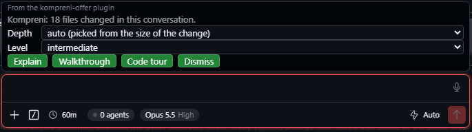

# Kompreni

*Esperanto for "to understand".* Understand what an AI coding agent changed, why it changed, and how it fits into your codebase.

Agent completion summaries tell you what was done. Kompreni helps you build a mental model of how and why your code evolved.

## Requirements

- Claude Code.
- A git repository. Without one, Kompreni can only use what the conversation edited, and says that coverage may be incomplete.
- Optional:
    - Python 3.9 or later, to check every quoted snippet and line reference against the repo. Without it, Claude checks by hand and says so.
    - [Quarto](https://quarto.org), for walkthroughs with tabs and code annotations, rendered to HTML. Without it, walkthroughs are Markdown, and code tours are written as `.qmd` but not rendered.
    - The GitHub CLI `gh`, to draw on pull requests when explaining a branch.
    - For the optional mod: a Claude Code version with mod support (tested with 2.1.331).

## Install

```
/plugin marketplace add Bergam0t/kompreni-claude-code-skill
/plugin install kompreni@kompreni
/plugin install kompreni-offer@kompreni    # optional: buttons above the prompt box (a mod, see below)
```

The mod runs as code inside Claude Code and isn't sandboxed, so read [`hooks/register.tsx`](mods/kompreni-offer/hooks/register.tsx) before installing it.

To update: `/plugin marketplace update kompreni`, then `/plugin update kompreni@kompreni` (and `kompreni-offer@kompreni` if you have the mod). To remove: `/plugin uninstall kompreni@kompreni`.

To try it without installing:

```
git clone https://github.com/Bergam0t/kompreni-claude-code-skill
claude --plugin-dir kompreni-claude-code-skill
```

Add `--plugin-dir kompreni-claude-code-skill/mods/kompreni-offer` to try the mod too.

## Quick start

After Claude has changed some code:

```
/kompreni:explain                 # explain the changes in the chat
/kompreni:walkthrough             # write them up as a document to keep
/kompreni:walkthrough code=all    # a code tour: every changed line, annotated
```

Or just ask: "explain what you changed" gives you an explanation, and "write a walkthrough of this" gives you the document. Neither runs on its own after a task.

## Use

### Which one?

|  | Explain | Walkthrough | Code tour |
|---|---|---|---|
| **Command** | `/kompreni:explain` | `/kompreni:walkthrough` | `/kompreni:walkthrough code=all` |
| **Output** | An answer in the chat; no files | A `.qmd` or `.md` file, rendered to HTML, meant to be committed | Same as a walkthrough, always `.qmd` |
| **Code shown** | Short verbatim snippets | One to three key excerpts, with before/after comparisons | All the substantive changed code, annotated line by line, with Before/After tabs |
| **Use when** | You want to understand a change now | A substantial change deserves a record for someone reading later: a reviewer, a teammate, or you in six months | You, or a reviewer, want to understand every changed line from the code itself |
| **Example** | [explain.md](examples/explain.md) | [walkthrough.html](https://bergam0t.github.io/kompreni-claude-code-skill/examples/walkthrough.html) ([source](examples/walkthrough.qmd)) | [code-tour.html](https://bergam0t.github.io/kompreni-claude-code-skill/examples/code-tour.html) ([source](examples/code-tour.qmd)) |

All three examples cover the same real change, so you can compare them directly. See [examples/](examples/).

### Explain

```
/kompreni:explain
/kompreni:explain depth=deep focus=src/api
```

**Several explanations in one conversation.** Each explanation covers only what changed since the previous one, and says how the new changes interact with the earlier ones. Use `scope=all` for one consolidated explanation of everything the conversation changed, e.g. before committing.

**Lessons that travel.** When a change teaches something beyond itself, a "Useful elsewhere" section says so: a library gotcha the change ran into, a design pattern worth reusing, or a debugging or testing technique that worked. Each item points to where it shows up in this change and is labelled with its evidence (see [How it works](#how-it-works)). It's left out when there's nothing real to say, which is often.

### Matching your experience

```
/kompreni:explain level=new-to-language
/kompreni:explain level="fluent in R, new to Python"
```

`level` sets how much language and library background is explained alongside the change:
- `new-to-programming` (or `beginner`): general programming concepts as well as the language;
- `new-to-language`: syntax, idioms, gotchas and libraries, for experienced programmers;
- `intermediate` (the default): only less-common features;
- `advanced`: no background at all;
- or describe yourself in free text, and new constructs are explained by comparison with what you know.

If you don't give a level, Kompreni uses `intermediate`, unless something in this conversation, your `CLAUDE.md` or Claude's memory describes your experience (for example "I'm new to Python"). The level used is named in the first line, so you can correct it.

### Explaining history: a branch, a commit, or a range

```
/kompreni:explain branch=feature-x              # what the branch adds over the default branch
/kompreni:explain branch=feature-x onto=develop
/kompreni:explain commit=abc1234
/kompreni:explain since=v1.2.0
```

In history mode the conversation can't say why something was done, so the explanation draws on commit messages, the pull request (if the GitHub CLI `gh` is available) and the code. Each reason is labelled with its source. If the commit sequence shows an approach that was tried and replaced, or fixes made after review, it adds a short "How it got here". The skill never checks out, stashes or resets anything.

### Walkthroughs: a document worth keeping

For a substantial change, `/kompreni:walkthrough` writes a guided walkthrough to a file instead of the chat. It's for someone reading later, who wasn't in the conversation.

```
/kompreni:walkthrough
/kompreni:walkthrough branch=feature-x level=new-to-language
/kompreni:walkthrough commit=abc1234 format=md
/kompreni:walkthrough code=all            # a code tour: every changed line, annotated
```

**What it changes in your repo.** It writes the walkthrough to `kompreni/walkthroughs/<date>-<slug>.qmd` (or `.md`), meant to be committed; `out=` changes the folder. If the changes aren't committed yet, it first asks whether to commit them, saying what it would commit and with what message. Only the session's own changes are committed, and nothing is pushed. A walkthrough tied to a commit keeps references that can always be checked and, on GitHub, permalinks. If you say no, the walkthrough notes that its line references point at the working tree as it was, and may drift.

- **Format**: Quarto (`.qmd`) if Quarto is installed or your repo is already a Quarto project, otherwise GitHub-flavoured Markdown (`.md`). Force one with `format=qmd|md`.
- **Rendering**: a `.qmd` is rendered to a single self-contained HTML file next to it, with a light/dark toggle. If the folder has no `.gitignore`, one is created to keep the HTML out of git. An existing one is left alone, so if you use `out=`, check that it ignores `*.html`.
- **Inside an existing Quarto project**: the walkthrough isn't rendered by default, because Quarto would send it into your site's output, and your site's own theme and layout apply. Exclude `kompreni/` in your `_quarto.yml` if you don't want walkthroughs on your site.
- **What's in it**:
    - the problem, then one concrete example traced through the code before and after the change;
    - annotated excerpts and before/after comparisons: in Quarto, Before/After tabs with the changed, added and removed lines marked; in Markdown, two labelled blocks;
    - a diagram, only if the flow changed;
    - the decisions with their evidence, honest verification, limitations, and a few questions with hidden answers (`quiz=off` to leave them out);
    - "Useful elsewhere", when the change teaches something that applies beyond it (also listed in the front matter, so these lessons can be searched across walkthroughs later).
- **Code tour** (`code=all`): instead of a few key excerpts, it shows all the substantive changed code, with a little context, in order of the call flow. It uses Quarto code annotations: numbered markers on the lines, with explanations below each block that highlight their lines when clicked. Line numbers match the real files. Every block from a file that already existed has Before and After tabs covering the same whole unit, so the old and new code can be compared in place. New files and tests have no tabs. Test changes are annotated inside collapsed sections, and housekeeping is summarised. A code tour is always `.qmd`, rendered to HTML only if Quarto is installed. With `format=md`, it asks which you want.
- **Proportionate**: for a small change it suggests `/kompreni:explain` instead, and asks before writing.
- **Front matter** records the range, commits, files, level and tests (`kompreni:` in the YAML). This is the start of Kompreni's searchable change history.

The skill shares `level=`, `focus=` and history mode with `/kompreni:explain`. It covers the whole conversation by default (`scope=all`).

### Optional: buttons above the prompt (the kompreni-offer mod)

A mod is a plugin that changes Claude Code's own interface. The [`kompreni-offer`](mods/kompreni-offer/) mod shows a row above the prompt whenever Claude isn't working (or, with `/kompreni-offer show=changes`, only after turns that edited files). It counts the files changed since the last explanation, and has depth and level pickers and **Explain**, **Walkthrough** and **Code tour** buttons that fill in the command for you. You press Enter; it never submits for you. It remembers your depth and level across sessions. The skill works fine without it.



After the first explanation, a Scope picker appears (since the last explanation, or the whole conversation). When there's nothing new to explain, the row shrinks to one line, with a **Whole conversation** button instead.

`/kompreni-offer off` hides it (`on` brings it back), and `/kompreni-offer` on its own shows the current settings. The count only includes files edited with Claude's file-editing tools, not changes made through shell commands, but the explanation still covers those because it reads git. More in the [mod's README](mods/kompreni-offer/README.md).

### All options

Every option is a `key=value` pair after the command, and all are optional. A ✓ means the command accepts it. The mod fills in only some of them, but the command lands in your prompt box, so you can add any other option before pressing Enter.

| Option | Values (default first) | Explain | Walkthrough / code tour | In the kompreni-offer mod |
|---|---|:-:|:-:|---|
| `depth` | auto, `brief`, `standard`, `deep` | ✓ | ✓ `standard` or `deep` only | Depth picker, remembered across sessions. Walkthrough buttons pass it only if it's `standard` or `deep` |
| `level` | auto, `new-to-programming` (`beginner`), `new-to-language`, `intermediate`, `advanced`, or free text in quotes | ✓ | ✓ | Level picker, remembered across sessions. Set free text with `/kompreni-offer level="..."` and it joins the picker |
| `scope` | Explain: `new`, `all`. Walkthrough: `all`, `new` | ✓ | ✓ | Scope picker (or a **Whole conversation** button on the one-line row), shown after the first explanation, for the session only. Used by Explain; walkthrough buttons never pass it |
| `focus` | a path or topic | ✓ | ✓ | No |
| `branch` (with `onto`), `since`, `commit` | a branch, ref or commit; at most one of the three | ✓ | ✓ | No: the mod is for this session's changes |
| `code` | `key`, `all` | | ✓ | The **Code tour** button fills in `code=all` |
| `format` | auto (`qmd` if Quarto is installed or the repo is a Quarto project), `qmd`, `md` | | ✓ | No |
| `out` | `kompreni/walkthroughs` or another folder | | ✓ | No |
| `render` | `auto`, `yes`, `no` | | ✓ | No |
| `quiz` | `on`, `off` | | ✓ | No |
| `title` | taken from the changes, or your own in quotes | | ✓ | No |

The mod has settings of its own, which aren't skill options: `on`/`off`, `show=always|changes` and `command=`. See the [mod's README](mods/kompreni-offer/README.md#settings-kompreni-offer).

## How it works

- **Git** supplies what changed (including edits made through shell commands). **The conversation** supplies why.
- Changes are grouped by purpose, not file, and the depth (brief, standard or deep) is matched to the size of the change.
- Every reason is labelled with its source: *(code)* the code or diff shows it, *(stated)* someone said it in the conversation, *(observed)* it was seen happening in the session (an error, a test result), *(commit `sha`)* or *(PR #n)* in history mode, and *(inferred)* Claude's own reasoning. Motives and history are never made up, and you can tell what's known from what's inferred.
- **Snapshots**: to make "since the previous explanation" reliable, each explanation of this session's changes ends with a line like `Kompreni snapshot: tree=4f2a91c… head=51d0a3b…`. That's a git snapshot of your working tree, taken without changing your files, index, branches or stash. Its only side effect is unreferenced objects inside `.git`, which git cleans up in time. Untracked files over 5 MB are left out of it.
- Quoted code is copied verbatim with its location, or marked `illustrative`. A small script (`skills/explain/scripts/check_refs.py`, Python 3.9+, standard library only) checks every snippet and `file:line` reference against the repo before the explanation or walkthrough is shown. It understands both Markdown and Quarto code blocks, and GitHub permalinks. It can't check that the prose about the code is right.
- **Before/After marks**: in Quarto, the lines a change touched are tinted yellow (changed), green (added) or red (removed; never hidden), with a `~`, `+` or `−` beside the line number so the kind doesn't rely on colour. A second script (`skills/explain/scripts/before_range.py`) maps each After block to the matching old lines through the diff, and gives these marks.
- Verification reports only tests actually run in the session.
- Changes in git that the session didn't make (your own uncommitted work) are listed separately.

## Relation to codebase-tutorial

[codebase-tutorial](https://github.com/Bergam0t/tutorial-codebase-knowledge-claude-code-skill) explains how a codebase works. Kompreni explains how and why it changed.

## Testing

- Unit tests for the reference checker, the snapshot script and the Before-range script: `python -m unittest discover tests`
- Mod tests: `claude plugin test mods/kompreni-offer`
- Manual scenarios and the scoring rubric: [evals/README.md](evals/README.md)

## Roadmap

Version 0.1.0. Next: persistent knowledge that can be searched across walkthroughs, starting from their front matter. See [HANDOVER-original.md](HANDOVER-original.md).
