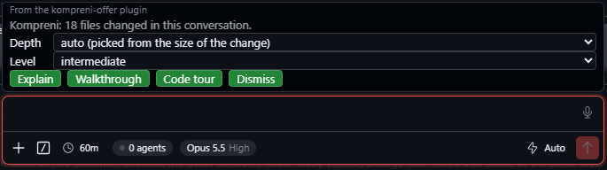
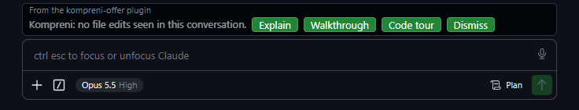
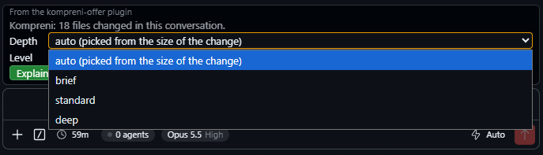
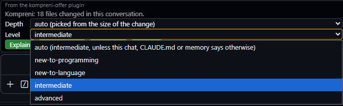

# kompreni-offer (optional mod)

An optional companion to the `kompreni` skill. It shows a row above the prompt, whenever Claude isn't working:



(After the first explanation, a Scope picker appears above Depth.)

When there's nothing new to explain, it shrinks to one line, and Explain uses your remembered depth and level:



(**Whole conversation** appears only after an explanation, and opens the full row with that scope chosen.)

**When it shows** (`/kompreni-offer show=...`):

- `always`, the default: whenever Claude isn't working, even before any edits, when it is the one-line form. This is still useful because edits made through shell commands aren't counted, but the skill finds them in git. **Dismiss** hides the row until the next turn finishes.
- `changes`: only after a turn in which Claude edited files. **Dismiss** hides the row until the next turn that edits something.

The count matches what the skill will explain: files edited since the last Kompreni explanation in this session, across however many turns. It resets when an explanation or a walkthrough actually runs, whether you used a button, typed the command, or asked Claude in words. History-mode runs (`branch=`, `since=`, `commit=`) don't reset it. Dismissing the row doesn't reset the count either.

After the first explanation, a **Scope** picker appears: *since last explanation* (the default) or *whole conversation*, which fills in `scope=all` and counts every file changed in the session. The choice lasts for the session only.

**Explain** fills your prompt box with the command, e.g. `/kompreni:explain depth=deep level=new-to-language`. You press Enter. It never submits for you, and it never overwrites a draft you've started.

**Walkthrough** and **Code tour** do the same for `/kompreni:walkthrough`, which writes a persistent Quarto or Markdown document instead of answering in the chat. **Code tour** adds `code=all`: every changed line, explained with Quarto code annotations. Both use your level, and your depth only if it's `standard` or `deep` (otherwise the skill sizes the walkthrough itself). They never pass a scope: a walkthrough covers the whole conversation. The two buttons appear only if the walkthrough skill is installed.

The depth and level you pick are remembered across sessions. Each picker's **auto** option says what it does: depth is picked from the size of the change, and level is intermediate unless this conversation, your `CLAUDE.md` or Claude's memory says something about your experience (e.g. "I'm new to Python"). The explanation's first line says which level it used and where that came from.





## Requirements

- Claude Code with mod support (built and tested against 2.1.331).
- The Kompreni explain skill, as the `kompreni` plugin (`/kompreni:explain`) or as a plain skill named `kompreni-explain`. The mod finds whichever is installed.
- For the Walkthrough and Code tour buttons, the walkthrough skill (`/kompreni:walkthrough` or `kompreni-walkthrough`), from the same plugin.

## Load it

Installed copies update only when the version in `.claude-plugin/plugin.json` changes, so bump it with every change you want installed users to receive. To pick up a new version: `/plugin marketplace update kompreni`, then `/plugin update kompreni-offer@kompreni`.

- **CLI, for trying it:** `claude --plugin-dir <this folder>` (add another `--plugin-dir` for the skill if it isn't installed).
- **Installed:** `/plugin install kompreni-offer@kompreni` from this repository's marketplace.

## Settings: `/kompreni-offer`

```
/kompreni-offer                                   # show current settings
/kompreni-offer off                               # hide the row entirely (on to resume)
/kompreni-offer show=changes                      # only after turns that edit files (show=always to go back)
/kompreni-offer depth=brief
/kompreni-offer level="fluent in R, new to Python"
/kompreni-offer command=kompreni-explain          # force which skill command to use
```

A free-text level set here appears as an extra option in the Level picker.

## Limitations

- It notices edits made with Claude's Edit, Write and NotebookEdit tools, including by subagents. They aren't counted when files change **only** through shell commands, so with `show=changes` no offer appears. With `show=always`, or by running the skill yourself, the explanation still covers them, because the skill reads the real changes from git.
- With `show=changes`, offers appear only after the main conversation's turns finish with an answer, not after interrupted turns.
- Mods are a new, evolving part of Claude Code and are not sandboxed. Read `hooks/register.tsx` before loading it.

## Development

- `claude plugin validate .`
- `claude plugin test .` runs `tests/register.test.tsx`
- Type-check: Claude Code writes the API types into `.claude-plugin/types/` when it loads the mod, after which `tsc -p .` works.
